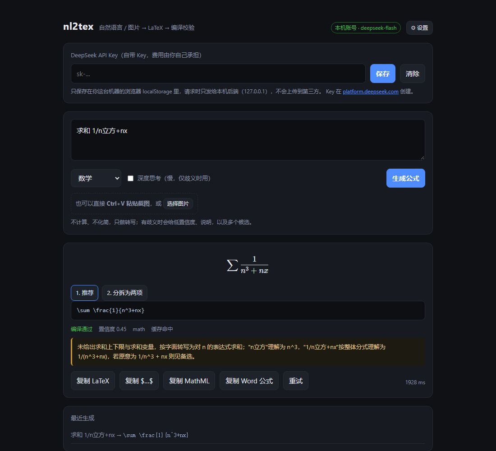

# nl2tex

用一句中文（或英文）描述一个公式，得到**能直接编译**的 LaTeX。

不是聊天机器人，是一个只做一件事的转写工具：**只转写，不计算、不化简、不猜**。描述有歧义时，它会给出低置信度和说明，而不是编一个看起来合理的答案。

```
输入：求 k 从 1 到 n 的 k 平方
输出：\sum_{k=1}^{n} k^{2}
```



## 它解决什么问题

手写 LaTeX 的门槛不在语法，而在"想到那个符号叫什么"。你知道要写求和，但不确定是 `\sum_{k=1}^{n}` 还是 `\sum\limits_{k=1}^n`；你知道要写下标，但多字母下标忘了 `\mathrm{}`。nl2tex 让你用自然语言说，它负责翻成规范写法，并且**当场用 KaTeX 编译一遍**，编不过就带着错误信息重试。

## 特性

- **编译校验**：每条结果都过 KaTeX，失败自动带错误重试一次，不会给你一段贴进去就报错的代码
- **歧义显式化**：`confidence` + `note`，低于 0.6 会告诉你它在哪猜了，并给出最多 3 个候选解读
- **图片识别**：直接 `Ctrl+V` 粘贴公式截图，或选图片，走同一个模型（`deepseek-flash` 原生视觉）
- **多种导出**：LaTeX、`$...$`、MathML、Word 公式（OMML）
- **六个学科**：数学 / 物理 / 化学 / 计算机 / 经济统计 / 生物，各有专属规则（化学强制 `\ce{}`、物理带单位写法等）
- **两种鉴权**：在页面里填自己的 DeepSeek API Key（推荐），或用环境变量；本机登录过 DSH 的话也能直接复用账号
- **本地优先**：只监听 `127.0.0.1`，公式不出本机（除了发给模型）
- **零构建**：纯 ESM + 原生 Node，`git clone` 完就能跑

## 快速开始

需要 Node ≥ 20。

```bash
git clone https://github.com/YHD-yhd-coder/nl2tex.git && cd nl2tex
pnpm install          # 或 npm install
pnpm start            # 打开 http://127.0.0.1:8777
```

然后点右上角 **⚙ 设置**，填入你自己的 DeepSeek API Key（[在这里创建](https://platform.deepseek.com/api_keys)）。

**自带 Key，费用你自己承担**：单次约 ¥0.001，充 ¥10 够用几千次。Key 只存在你本机的浏览器 `localStorage`，请求时只发给本机后端。

也支持其它两种方式（按优先级）：

```bash
# 环境变量
export DEEPSEEK_API_KEY=sk-xxxx     # Windows: $env:DEEPSEEK_API_KEY="sk-xxxx"

# 或者：本机已登录 DSH，直接复用它的账号（本地开发方便，不用另配 Key）
```

> 注意：DSH 账号模式依赖 DSH 的登录态文件，只适合本机自用。开源分发时请让用户用自己的 Key。

## 命令行

```bash
node cli.mjs "积分从 0 到无穷 e 的负 x 平方 dx"
node cli.mjs "水的化学式" --subject=chemistry
node cli.mjs "牛顿第二定律" --json
```

## HTTP 接口

```http
POST /api/nl2tex
{ "text": "求和 1/n立方+nx", "subject": "math" }
```

返回：

```json
{
  "latex": "\\sum \\frac{1}{n^3+nx}",
  "valid": true,
  "confidence": 0.45,
  "note": "未给出求和上下限与求和变量……",
  "alternatives": [
    { "label": "推荐", "latex": "\\sum \\frac{1}{n^3+nx}" },
    { "label": "分拆为两项", "latex": "\\sum \\left(\\frac{1}{n^3}+nx\\right)" }
  ],
  "html": "<span class=\"katex\">…</span>",
  "usage": { "input_tokens": 244, "output_tokens": 72 },
  "ms": 1928
}
```

图片识别：

```http
POST /api/ocr
{ "image": "<base64 或 dataURL>", "mediaType": "image/png", "subject": "math" }
```

导出：

```http
POST /api/export
{ "latex": "\\frac{a}{b}", "to": "mathml" }   // 或 "omml"
```

`GET /api/health` 返回鉴权方式、模型、学科列表。

## 评测

```bash
pnpm test        # 20 条文本用例
pnpm test:ocr    # 图片识别冒烟测试（用 test/fixtures/formula.png）
pnpm bench       # 延迟分位
```

当前基线（`deepseek-flash`，关思考）：

| 指标 | 数值 |
|---|---|
| 编译通过 | 20/20 |
| 关键词命中 | 19/20 |
| 平均耗时 | ~0.9 s |
| 单次成本 | ~¥0.001 |

## 成本

单次请求约 700–900 token，按 `deepseek-flash` 峰时价约 **¥0.001/次**；命中上下文缓存后更低。每天 500 次约 ¥15/月。

开 `--thinking` 会慢 3–5 倍、贵 4 倍左右，只在公式高度歧义时用。

## 设计取舍

**为什么不做"一步到位算出答案"？**
因为答案对不对无法自动验证，公式能不能编译却可以。把能力限定在"可验证的转写"上，才能给出可信的 `valid` 字段。

**为什么关掉思考模式？**
转写是模式匹配，不是推理。实测关掉后单次 0.2–1.5 s，开启后 2.7 s 起、输出 token 多 8 倍。歧义场景才值得开。

**为什么限制危险命令？**
KaTeX 以 `trust: false` 渲染，并拒绝 `\href`、`\includegraphics`、`\newcommand` 等，避免从描述注入。公式长度上限 4000 字符。

## 已知限制

- 只做转写：让它"顺便解个方程"不会给出答案
- 复杂排版（多行对齐、长推导）需要人工微调
- 化学依赖 KaTeX 的 mhchem 扩展，个别写法可能不被支持
- 中文口语的地道表达（"根号下"、"以 e 为底"）覆盖较好，方言/缩写未系统测试

## 路线图

- [x] 歧义时返回 2–3 个候选
- [x] MathML / Word（OMML）导出
- [x] 截图识别（粘贴即用）
- [ ] DSH 输入框插件（在聊天框里直接按按钮生成）
- [ ] 手写笔迹识别（不依赖图片）
- [ ] 历史记录持久化

## 许可

MIT

---

**English**: Turn a natural-language description into compilable LaTeX, validated with KaTeX. Not a chat bot: it only transcribes, never computes, and reports low confidence instead of guessing.
